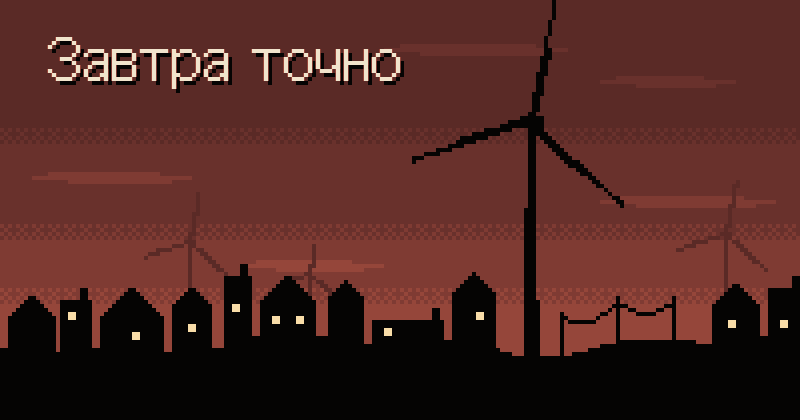

  

  <b>Завтра точно</b> (Tomorrow, I Promise) визуальная новелла о сложном выборе в пиксельном стиле, которая идёт в браузере и на телефоне.

  <a href="https://tomorrow-i-promise.ru/"><b>🎮 Играть</b></a>

---

### Управление

| Действие | Мышь / палец | Клавиатура           |
|---|---|----------------------|
| Следующая реплика | тап по экрану | `Пробел`, `Enter`    |
| Пауза | кнопка слева сверху | `Esc`                |
| Пункты меню | тап | ⬆️ ⬇️, выбор `Enter` |
| Громкость | ползунок | ⬅️ ➡️                |
| Во весь экран | кнопка справа сверху | —                    |

### Полный экран на телефоне

- **Android:** кнопка "Во весь экран" справа сверху.
- **iPhone:** Safari не даёт странице уйти в полный экран, поэтому "Поделиться" => "На экран Домой". С иконки игра открывается без панелей браузера.

### Языки

Игра на русском и английском: английская версия — [tomorrow-i-promise.ru/en/](https://tomorrow-i-promise.ru/en/), язык меняется кнопкой `RU / EN` справа сверху в главном меню.

Сценарий один, `story/main.ink`. Перевод лежит в таблице `story/locales/<код>.json`: ключ — русская строка, значение — перевод. `npm run story` подставляет перевод и собирает `story.<код>.json`, а если у строки нет перевода, показывает, какие строки перевести.

Как добавить язык:

1. `npm run locale -- <код>` и заполнить `story/locales/<код>.json`.
2. Скопировать `src/novel/i18n/en.ts` в `<код>.ts`, перевести и подключить в `STRINGS` в `src/novel/i18n/index.ts` (`npx tsc --noEmit` покажет пропущенные строки), добавить тексты для поисковиков в `src/novel/i18n/seo.ts`.
3. Добавить `{ "code", "name" }` в `src/novel/i18n/languages.json`.
4. `npm run story` проверит, что все символы есть в шрифте. Знаки, после которых печать делает паузу, — `STOPS` и `PAUSES` в `src/novel/useTypewriter.ts`. Пройти игру.

## Авторы

- Ивахненко Николай — [@nikolayivakhnenko](https://t.me/nikolayivakhnenko)
- Макарова Елизавета — [@displiceat](https://t.me/displiceat)
  
Музыка главного меню: Gregor Quendel, «Ambient Pad VII»

Шрифт [Galmuri11](https://github.com/quiple/galmuri) © Lee Minseo, лицензия SIL Open Font License 1.1

